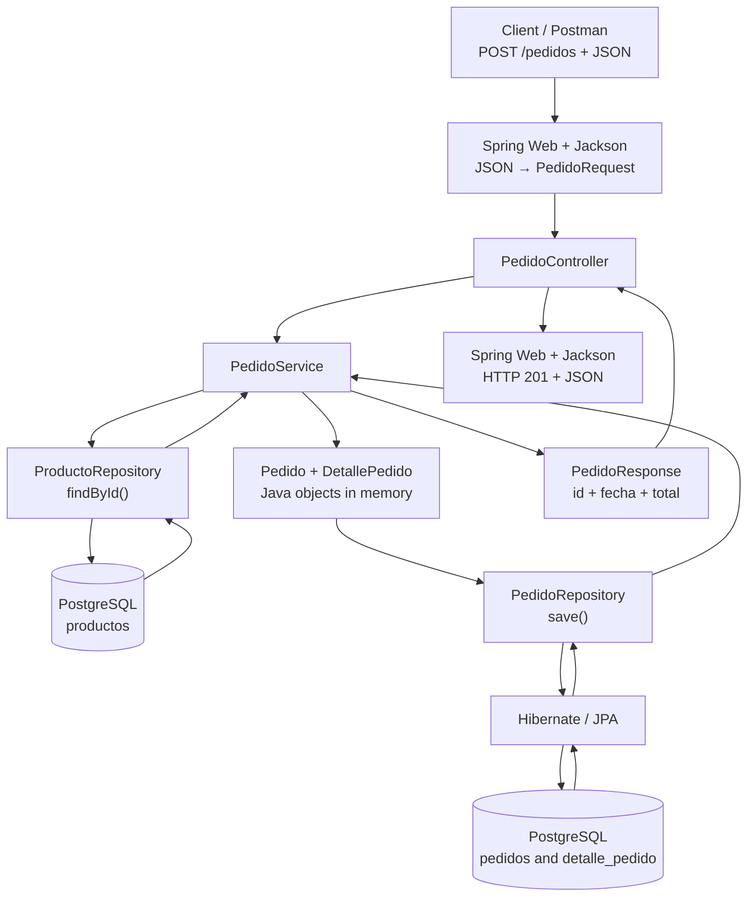
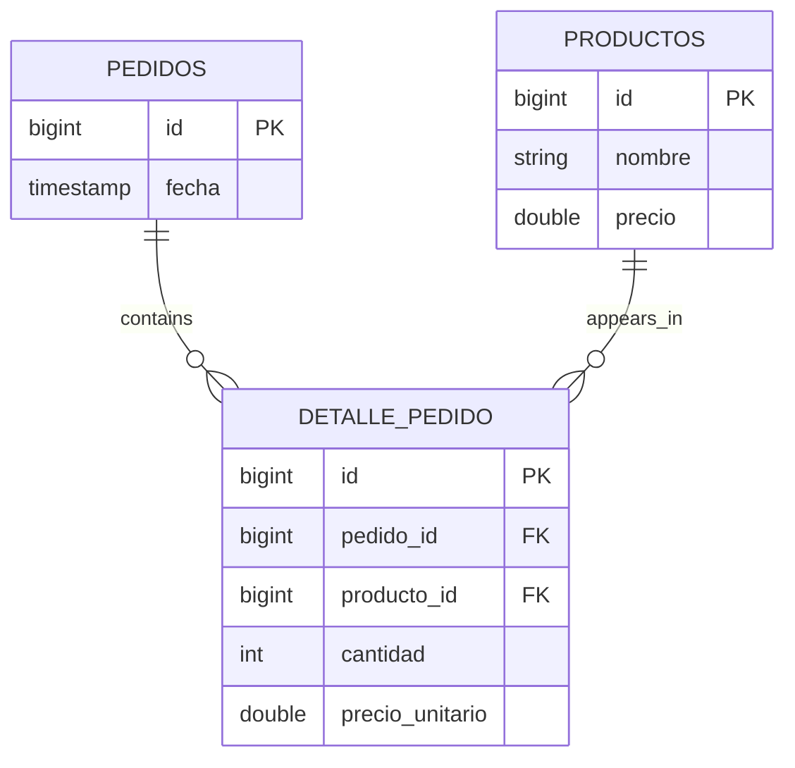

# Tienda — REST API with Java and Spring Boot

> **My first hands-on project with Spring Boot, PostgreSQL, and JPA.**  
> **Initial version:** `v0.1.0` · **Status:** work in progress

## What is this project about?

The idea behind this repository is to gradually build a REST API for a store while learning **Java backend development**. I started with something simple: creating and retrieving products. Then I added orders, order details, relationships between entities, and error handling.

I wasn't trying to build a complete commercial system from day one. My goal is to **understand what each part of the backend does**, test it, and then improve it. That's why I plan to keep track of the project's evolution through different versions.

In this first version, I can already receive an order as JSON, look up products that exist in the database, create the order details, calculate the total, and save everything in PostgreSQL.

## Technologies

| Technology | What do I use it for? |
| --- | --- |
| **Java** | The language I use to develop the application. |
| **Spring Boot** | Makes it easier to configure and run the backend. |
| **Spring Web** | Handles HTTP requests and returns REST API responses. |
| **Spring Data JPA** | Provides repositories and methods such as `save()`, `findById()`, and `findAll()`. |
| **JPA (Jakarta Persistence)** | Defines the annotations and rules for mapping Java entities to database tables. |
| **Hibernate** | Implements JPA and handles persistence operations in the database. |
| **PostgreSQL** | Stores products, orders, and order details. |
| **Jackson** | Converts JSON into Java objects and Java objects into JSON. |
| **Maven** | Manages dependencies and helps compile and run the project. |
| **Postman** | Lets me test endpoints by sending HTTP requests. |

## What can this version do?

### Products

- Create products with a name and price.
- Find a product by its ID.
- List the products stored in PostgreSQL.

### Orders

- Create an order with one or more order details.
- Specify an **existing product ID** and the desired **quantity** for each detail.
- Look up products from the backend to get their actual prices.
- Calculate the order total.
- Save an order together with its details using a JPA relationship and `cascade`.
- Retrieve orders through the endpoint that searches by ID.

### Errors

- Return **404 Not Found** when a requested product doesn't exist.
- Return **400 Bad Request** when the requested quantity is invalid (zero or negative).
- Handle those errors in one place using `GlobalExceptionHandler`.

---

## How I organized the classes

I chose a structure based on responsibilities. The idea is that **each layer should have a specific job**, instead of putting all the logic into the Controller.

| Class or group | Responsibility |
| --- | --- |
| `ProductoController`, `PedidoController` | Receive HTTP requests and return responses. |
| `ProductoService`, `PedidoService` | Coordinate the business logic. |
| `ProductoRepository`, `PedidoRepository` | Allow entities to be retrieved from and saved to the database. |
| `Producto`, `Pedido`, `DetallePedido` | Are the entities represented and managed by JPA/Hibernate. |
| `ProductoRequest`, `PedidoRequest`, `DetallePedidoRequest` | Represent the data received from the client. |
| `PedidoResponse` | Represents the data returned after creating an order. |
| `ProductoNoEncontradoException`, `CantidadInvalidaException` | Represent specific error situations. |
| `GlobalExceptionHandler` | Turns those exceptions into clear HTTP responses. |

One detail I found important: **the Controller shouldn't create or save orders itself**. The Controller receives the data and calls the Service. The Service builds the objects and uses the repositories. Finally, Spring/Hibernate take care of persistence.

## The complete flow: from JSON to a saved order

This was the part I most wanted to understand, because it's where almost all the classes come together.

### 1. The client sends JSON

For example, from Postman I send:

**`POST /pedidos`**

```json
{
  "detalles": [
    {
      "productoId": 2,
      "cantidad": 2
    },
    {
      "productoId": 3,
      "cantidad": 1
    }
  ]
}
```

In JSON, `detalles` is a **property** containing an **array** (`[]`). Each element in the array is an object (`{}`) with two properties: `productoId` and `cantidad`.

The client **doesn't send the price**, because the backend gets it from the product already stored in PostgreSQL.

### 2. Spring and Jackson convert the JSON into DTOs

The method in `PedidoController` receives the request body using `@RequestBody`.

Jackson reads the JSON property names and builds these objects:

```java
public record DetallePedidoRequest(Long productoId, int cantidad) {}

public record PedidoRequest(List<DetallePedidoRequest> detalles) {}
```

The result is **a `PedidoRequest` containing a list of `DetallePedidoRequest` objects**. Jackson knows how to convert a JSON array into a Java `List`.

One important detail: **Jackson hasn't created any JPA entities or saved anything yet**. It has only converted the incoming data into Java objects that the backend can work with.

### 3. The Controller calls the Service

`PedidoController` receives the `PedidoRequest` and passes it to `PedidoService.crearPedido()`.

### 4. The Service builds the order

Inside `PedidoService`:

1. I create a new `Pedido` using `new Pedido()`.
2. I go through the DTO's list using a `for-each` loop.
3. For each detail, I look up its `Producto` using `ProductoRepository.findById()`.
4. If the product exists, I create a `DetallePedido` object with the product, quantity, and unit price.
5. I add each detail to the order using `pedido.agregarDetalle(detalle)`.

I **no longer calculate the total inside the Service's `for` loop**: I moved that calculation into the `Pedido` entity, since it's the class that knows all its details.

The `agregarDetalle()` method does two things:

```java
public void agregarDetalle(DetallePedido detalle) {
    detalles.add(detalle);   // The order adds the detail.
    detalle.setPedido(this); // The detail knows which order it belongs to.
}
```

That second line matters: the detail needs to know which order it belongs to because **the `detalle_pedido` table is the one that stores the `pedido_id` foreign key**.

### 5. The Repository saves the data

Once the order is ready, the Service calls:

```java
Pedido pedidoListo = pedidoRepository.save(pedido);
```

This is where **Spring Data JPA and Hibernate** come in. Hibernate uses the annotations on the entities to save the order and its details in PostgreSQL. The database generates the order ID.

### 6. The response is built for the client

The Service calls `pedidoListo.calcularTotal()` and uses the result to create a `PedidoResponse`, together with the ID and date. Then it returns that DTO to the Controller, and Jackson converts it to JSON.

For example, in an actual test I got:

```json
{
  "id": 1,
  "fecha": "2026-10-27T14:48:41.1576743",
  "total": 174000.0
}
```

In the Controller, we use `@ResponseStatus(HttpStatus.CREATED)` to return **HTTP 201 Created** when the order is created successfully.

### Flow diagram



---

## A design improvement: why did I move `calcularTotal()` into `Pedido`?

At first, I calculated the total directly in `PedidoService` while looping through the details: I multiplied the quantity by the price and accumulated everything in a variable. **It worked**, but then I thought: if the order already has its own list of details, why not let `Pedido` calculate its total?

That's why I added this method to the `Pedido` entity:

```java
public double calcularTotal() {
    double total = 0;

    for (DetallePedido detalle : detalles) {
        total += detalle.getCantidad() * detalle.getPrecioUnitario();
    }

    return total;
}
```

Then, from `PedidoService`, after saving the order, I simply use that method when building the response:

```java
return new PedidoResponse(
        pedidoListo.getId(),
        pedidoListo.getFecha(),
        pedidoListo.calcularTotal()
);
```

### Which principle am I applying?

Mainly **high cohesion**: each class should handle operations related to the data it knows. `Pedido` has the details and knows how to calculate its total; `PedidoService` is responsible for **coordinating** order creation, looking up products, and saving the order.

This is also related to the **Single Responsibility Principle (SRP, the S in SOLID)**. It doesn't mean that a class should have only one method. It means that responsibilities belonging to the same concept should stay together, instead of mixing tasks that may change for different reasons.

**What I learned:** a JPA entity doesn't have to be just a collection of fields, getters, and setters. It can also contain its own business logic. And this doesn't change anything about `@Entity` or Hibernate: `calcularTotal()` is simply a Java method.

---

## Relationships between entities: what I learned about JPA

In Java, we have three main entities:

- **`Producto`**: represents something the store sells and can exist even if nobody has bought it yet.
- **`Pedido`**: represents a purchase, with its ID, date, and list of details.
- **`DetallePedido`**: represents an order line, with a product, a quantity, and a unit price.

### How are they related?

An order can contain **many details**, but each detail belongs to **one order**.



*This diagram is conceptual; some physical column names may vary depending on the Hibernate configuration.*

### Why does `Pedido` have a `List` but no foreign keys pointing to each detail?

In the `Pedido` class, we use something like this:

```java
@OneToMany(mappedBy = "pedido", cascade = CascadeType.ALL)
private List<DetallePedido> detalles = new ArrayList<>();
```

I found it interesting that **Hibernate knows how to work with Java collections such as `List`**. But that **doesn't mean it stores the whole `ArrayList` in a database column**.

In PostgreSQL, there is an orders table and a separate details table. The details have a `pedido_id` column that indicates which order they belong to. So, to find an order's details, the database can look for rows whose `pedido_id` matches that order.

On the `DetallePedido` side, the relationship looks like this:

```java
@ManyToOne
@JoinColumn(name = "pedido_id")
private Pedido pedido;
```

- `@OneToMany`: one order has many details.
- `@ManyToOne`: many details can point to the same order.
- `mappedBy = "pedido"`: refers to the **Java field** named `pedido` inside `DetallePedido`, not the database column name.
- `@JoinColumn(name = "pedido_id")`: specifies the column that stores the foreign key.

### Why does `DetallePedido` have `private Producto producto` instead of an ID?

This part made me think: in Java, inside `DetallePedido`, **we store a reference to a `Producto` object**, not just a number.

```java
@ManyToOne
@JoinColumn(name = "producto_id")
private Producto producto;
```

When the JSON arrives, the client does send a `productoId`. But that ID belongs to the **input DTO**, not to the `DetallePedido` entity. In `PedidoService`, we use `ProductoRepository.findById()` to find the existing product, and then we build the detail using that object.

In Java, the detail holds a reference to the **`Producto` object**. In PostgreSQL, Hibernate stores **the `producto_id` foreign key**, which points to that product's row. **It doesn't put a Java object inside a column or create a new product for every order.**

Also, multiple details (even from different orders) can refer to the same product. That's why this relationship is also `@ManyToOne`.

### What does `cascade` mean?

In our `Pedido`, we use:

```java
cascade = CascadeType.ALL
```

The idea is quite simple: **certain operations performed on an order are propagated to its details**. For example, when a new order is persisted, Hibernate can also persist its new details without me having to save each one manually.

But **we're not creating a new product for every order**. The products already exist, and we look them up using `ProductoRepository`. The `cascade` setting is on the relationship between `Pedido` and `DetallePedido`.

`CascadeType.ALL` includes other operations besides saving, such as removing related entities. For now, I used it to understand how persisting details works. I'll review its effects on other operations in future versions.

### Other ways to map a one-to-many relationship

While practicing, I tried to understand **what would happen if I changed `@OneToMany`**. It helped me separate three ideas: relationship mapping, where the reference is stored, and cascading persistence.

**1. Our current design: `@OneToMany(mappedBy = "pedido", cascade = CascadeType.ALL)`**

- `DetallePedido` has a `Pedido pedido` field with `@ManyToOne` and `@JoinColumn(name = "pedido_id")`.
- The `pedido_id` foreign key is stored in the `detalle_pedido` table.
- When I add a detail, I use `detalle.setPedido(this)` to associate it on the side that owns the foreign key as well.
- When I save a new order, `cascade` allows its new details to be persisted too.

**2. `@OneToMany` with no parameters**

```java
@OneToMany
private List<DetallePedido> detalles = new ArrayList<>();
```

If I design the relationship only from `Pedido` to `DetallePedido` (without the `Pedido pedido` reference on the other side), the unidirectional mapping uses **a real join table in PostgreSQL** to record the associations. Also, because I didn't configure `cascade`, saving the order **doesn't automatically save** the new details. I'd have to persist them separately, for example through `DetallePedidoRepository`.

**3. No `@OneToMany` and no list in `Pedido`**

I can keep only `@ManyToOne` in `DetallePedido`. In that case, I save the order first, assign that order to each detail, and save the details using their own repository. If I later want to retrieve them, I can declare this method in `DetallePedidoRepository`:

```java
List<DetallePedido> findByPedidoId(Long pedidoId);
```

Spring Data JPA generates the query based on the method name. **I don't need a list inside `Pedido` for the relationship to exist in PostgreSQL**, but I do need `@OneToMany` if I want to map that list as a JPA relationship and navigate using `pedido.getDetalles()`.

**My takeaway:** for this exercise, since a detail belongs to an order and is created along with it, I preferred the bidirectional relationship with the foreign key in `DetallePedido` and cascading persistence. A join table isn't bad practice by itself; it depends on the kind of relationship and the design.

### What about a field I don't want to save?

I also learned that if I have a field in an entity but **don't want to persist it**, I can use JPA's `@Transient`. For example, a temporary value calculated in Java that doesn't need its own column. This is different from Jackson annotations used to control JSON output.

### When does Hibernate come into play?

When I write:

```java
Pedido pedido = new Pedido();
```

I'm creating **a regular Java object in memory**. The constructor initializes the date and the list, but **nothing is saved to PostgreSQL**.

Hibernate learns how the entities are mapped from their annotations and, when I perform a persistence operation such as `save()`, it applies those mappings to work with the database.

---

## Annotations I used, grouped by technology

I think this distinction matters because, at first, it's easy to mix everything up and assume all annotations belong to the same framework.

### 1. JPA — `jakarta.persistence`

These annotations describe how our Java objects relate to database tables.

| Annotation | What does it tell JPA/Hibernate? |
| --- | --- |
| `@Entity` | That a class is a persistent entity. |
| `@Table(name = "...")` | The name of the table associated with the entity. |
| `@Id` | Which field is the primary key. |
| `@GeneratedValue(strategy = GenerationType.IDENTITY)` | That the ID is generated by the database when a row is inserted. |
| `@OneToMany` | That an entity can have multiple related instances of another entity. |
| `@ManyToOne` | That multiple entities can refer to the same entity. |
| `@JoinColumn(name = "...")` | Which column stores the foreign key. |
| `@Transient` | Marks a field as not persistent (a concept I learned, but don't need in the current entities). |

I also learned that **I don't have to add `@Column` to every simple field**: JPA can map those fields by default. If I later need to customize column names or constraints, I can add it.

### 2. Spring Data JPA — repositories

There's an important distinction here: **`JpaRepository` isn't an annotation**. It's a Spring Data JPA interface.

For example:

```java
public interface PedidoRepository extends JpaRepository<Pedido, Long> {
}
```

`Pedido` is the entity, and `Long` is the type of its primary key. The order of those generic parameters matters.

By extending `JpaRepository`, I get methods such as:

| Method | What does it do? |
| --- | --- |
| `save(entidad)` | Saves a new entity or updates an existing one, depending on the case. |
| `findById(id)` | Looks up an entity by its primary key and returns an `Optional`. |
| `findAll()` | Returns the entities found. |
| `deleteById(id)` | Requests the deletion of an entity by ID. |

In this project, we use `PedidoRepository` to save orders and their details. **I didn't need to create a `DetallePedidoRepository`** for that operation because I configured `cascade`.

### 3. Spring Web — endpoints and HTTP responses

| Annotation | What does it do? |
| --- | --- |
| `@RestController` | Marks a class as a REST controller; its methods write content into the HTTP response. |
| `@RequestMapping("/pedidos")` | Defines a base route for the controller's endpoints. |
| `@GetMapping` | Maps a Java method to HTTP GET requests. |
| `@PostMapping` | Maps a Java method to HTTP POST requests. |
| `@RequestBody` | Tells Spring to read the request body; Jackson can convert its JSON into a DTO. |
| `@PathVariable` | Reads a value from the URL path, such as a product ID. |
| `@ResponseStatus(HttpStatus.CREATED)` | Sets HTTP 201 as the success status when an order is created. |
| `@RestControllerAdvice` | Makes it possible to centralize REST controller error handling. |
| `@ExceptionHandler` | Specifies which exception a handler method deals with. |

Another thing I learned: `@RestController` **doesn't replace** `@RequestBody`. One defines what kind of controller we have and how responses are handled; the other tells Spring where to get the input data.

### 4. Spring Core — services and dependency injection

In our service classes, we use `@Service`, which allows Spring to register the service as a **bean**.

Then we use **constructor-based dependency injection**. This way, `PedidoService` can receive `ProductoRepository` and `PedidoRepository` without having to create them with `new`.

---

## Jackson, DTOs, and JSON: what converts what?

**Jackson is a Java library; it isn't part of the JDK.** Spring Boot commonly uses it to convert JSON data.

It has two main jobs:

- **Deserialization:** incoming JSON → Java objects.
- **Serialization:** Java objects → JSON sent to the client.

In our case, Jackson sees the `"detalles"` property, recognizes that the DTO expects a `List<DetallePedidoRequest>`, and creates one Java object for each object in the JSON array.

The JSON property names need to match the DTO components unless we add special configuration.

### Why did I use DTOs instead of receiving the entities directly?

Because **the client doesn't need to know the entire internal database structure**. To create an order, it's enough to specify product IDs and quantities. The client shouldn't assign the order ID, date, or the price we'll use.

For the output, we created `PedidoResponse`, which includes only:

- `id`
- `fecha`
- `total`

This keeps **the data entering and leaving the API** separate from **the entities managed by Hibernate**.

Another small difference I learned: `Long` can be `null`, but the primitive `long` cannot. I use `Long` for the incoming `productoId` because it lets me distinguish a missing value from a numeric value such as `0`.

---

## How I handled errors

At first, I could have thrown a generic `RuntimeException`, but I chose to practice **custom exceptions** and return meaningful HTTP status codes.

### Custom exceptions

| Exception | When does it happen? | HTTP status |
| --- | --- | --- |
| `ProductoNoEncontradoException` | An order references a product that doesn't exist. | **404 Not Found** |
| `CantidadInvalidaException` | The requested quantity is zero or negative. | **400 Bad Request** |

For example, in the Service I search for a product with `findById()` and, if it doesn't exist, I can throw the corresponding exception using `orElseThrow()`.

I also check that the quantity is positive **before creating the detail**. That prevents me from saving something like `-5` units of a product.

### How does an exception become an HTTP response?

For that, we have a `GlobalExceptionHandler` class annotated with `@RestControllerAdvice`. Inside it, each method with `@ExceptionHandler` handles a specific exception type and sets the HTTP status using `@ResponseStatus`.

For example, if we send an invalid quantity, the API can respond with:

**HTTP 400 Bad Request**

```json
{
  "mensaje": "La cantidad debe ser mayor a cero"
}
```

If the product doesn't exist, the API returns **HTTP 404 Not Found** with an explanatory message.

**One important detail:** throwing a custom exception doesn't automatically make it an HTTP 400 or 404 response. **The exception handler is what defines that HTTP status**.

On the other hand, when the order is created successfully, the Controller returns **201 Created** using `@ResponseStatus(HttpStatus.CREATED)`.

For now, that annotation is enough for me. Later, I also want to practice `ResponseEntity`, which offers more flexibility to control a response's status, headers, and body.

---

## Main endpoints

| Method | Route | What does it do? |
| --- | --- | --- |
| `POST` | `/productos` | Creates a product. |
| `GET` | `/productos` | Lists the products. |
| `GET` | `/productos/{id}` | Finds a product by ID. |
| `POST` | `/pedidos` | Creates an order with its details. |
| `GET` | `/pedidos/{id}` | Retrieves an order by ID. |

The server uses the port configured in Spring Boot (`8080` by default, unless changed).

### My Postman test

To test `POST /pedidos`, I first checked which products already existed. At that point, I had products with IDs **2 and 3**, so I sent an order containing both.

The backend returned a new order with **ID 1** and a **total of 174000.0**. Then I checked PostgreSQL and found **two new details**, with primary keys 1 and 2, associated with the order.

This test confirmed that the Service built the order, `save()` persisted it, and Hibernate also saved the details thanks to `cascade`.

I can also verify it directly in PostgreSQL:

```sql
SELECT * FROM pedidos;

SELECT * FROM detalle_pedido;

SELECT * FROM detalle_pedido WHERE pedido_id = 1;
```

---

## How to run the project locally

1. Have a **JDK compatible with the version specified in `pom.xml`**, Maven, and PostgreSQL installed.
2. Create a local database named **`tienda`**.
3. Create `src/main/resources/application.properties` locally and configure the PostgreSQL connection with your own URL, username, and password. Also configure Hibernate's schema management behavior for your local environment.
4. Run the application from IntelliJ IDEA or, with Maven installed, from the project's root directory:

   ```bash
   mvn spring-boot:run
   ```

5. Test the endpoints with Postman, for example `http://localhost:8080/productos` and `http://localhost:8080/pedidos`.

> **Security:** the real `application.properties` file is excluded from the repository through `.gitignore` because it contains local credentials. I don't publish passwords or private configuration files.

## What I want to improve in future versions

This is my **first learning version**, so there are several things I want to add gradually:

- Improve input validation (for example, empty orders or missing data).
- Add automated tests using JUnit and Mockito.
- Manage product stock.
- Learn to use transactions with `@Transactional` when updating orders and stock.
- Review appropriate types for monetary values, such as `BigDecimal`.
- Practice `ResponseEntity` and more complete HTTP responses.
- Add Docker to make the application easier to run on other computers.

The idea is **not to add everything at once**, but to understand each concept, test it, and only then move forward.

---

## What I learned from this first version

The most important thing I learned wasn't memorizing annotations, but understanding how data moves through the application:

**The client sends JSON → Jackson converts it into DTOs → the Controller calls the Service → the Service builds entities and uses repositories → Hibernate works with PostgreSQL → we create an output DTO and Spring sends the response to the client.**

I also saw in practice how a `Pedido` has a `List<DetallePedido>` in Java, while in PostgreSQL that relationship is represented using **tables and foreign keys**.

This repository will continue to grow as I progress with **Java Backend and Spring Boot**.
